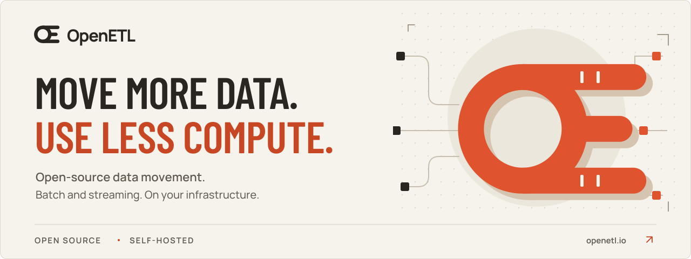

# OpenETL: Batch and streaming data integration

[](https://openetl.io)

<p align="center">
  <a href="https://github.com/openetl-io/openetl/actions/workflows/nightly.yml?query=event%3Aschedule"></a>
  <a href="https://sonarcloud.io/summary/new_code?id=openetl-io_openetl"></a>
  <a href="https://sonarcloud.io/summary/new_code?id=openetl-io_openetl"></a>
  <a href="https://sonarcloud.io/summary/new_code?id=openetl-io_openetl"></a>
  <a href="https://sonarcloud.io/summary/new_code?id=openetl-io_openetl"></a>
</p>

OpenETL is a self-hosted, open-source data integration platform for batch and streaming ETL/ELT pipelines. Replicate databases with change data capture (CDC), ingest HTTP APIs and events, and load data into warehouses and data lakes.

Its [Rust data engine](docs/internals/engine.md) uses Apache Arrow and runs SQL transforms, including stateful stream processing. Define pipelines as YAML and run on your own infrastructure under the [Apache 2.0 license](LICENSE).

[Quickstart](docs/get-started/quickstart.md) · [Documentation](https://docs.openetl.io) · [Connectors](https://github.com/openetl-io/openetl-connectors) · [Self-host](docs/self-host/index.md)

> [!NOTE]
> OpenETL is in alpha. The pipeline format and the API can change between releases.

## What you can do with it

- **Batch and streaming in one platform.** Run scheduled full refreshes and incremental syncs, or continuous CDC and event streams, with [compatible connectors](docs/pipelines/connectors.md).
- **Stateful SQL transforms.** Filter and reshape rows, aggregate [event-time windows](docs/pipelines/windows.md), compute [running totals](docs/pipelines/over.md), and [deduplicate by key](docs/pipelines/dedupe.md). Checkpointed state survives retries.
- **Checked delivery guarantees.** Require exactly-once delivery where supported. OpenETL [checks each stream](docs/pipelines/delivery.md) and refuses pipelines that cannot meet their required guarantee.
- **Controlled schema evolution.** Add new columns by default and require permission for destination type changes. [Hold affected values and release them after repair](docs/pipelines/schema-changes.md), where supported, or [quarantine invalid rows](docs/pipelines/holds-and-quarantine.md).
- **Resource sizing and distributed jobs.** Size CPU and memory automatically within your limits. Spread [compatible jobs across Kubernetes workers](docs/pipelines/workers.md), with [KEDA runner scaling and spot-node support](docs/self-host/kubernetes.md).
- **dbt, Spark and Flink integrations.** Run [dbt after a scheduled sync](docs/integrate/dbt.md), [Spark batch transforms](docs/integrate/spark.md), or [Flink streaming jobs](docs/integrate/flink.md) coordinated with destination commits.
- **Recovery and visibility.** Resume from checkpoints after failures. Run [connection checks and pipeline preflights](docs/use/checks.md). Monitor freshness and incidents in the console, with [OpenTelemetry](docs/integrate/telemetry.md) and signed [webhooks](docs/integrate/webhooks.md).
- **Pipelines as code.** Keep YAML in git. Review changes with `openetl plan` before `openetl apply`, or automate through the [REST and gRPC API](docs/integrate/api.md).
- **Connectors you can extend.** Install official, community or private connectors. Define [HTTP API sources as manifests](docs/reference/manifest.md), or [build a connector](docs/build-connectors/index.md) with the Go SDK or gRPC.

## Get started

You need macOS or Linux, and [Docker](https://docs.docker.com/get-started/get-docker/) with Compose. Install the `openetl` CLI:

```sh
curl -fsSL https://raw.githubusercontent.com/openetl-io/openetl/main/install.sh | sh
```

It installs the newest release, and shows a line to add to your shell's profile if `openetl` is not on your `PATH`. Start the same release with Docker Compose, in a new directory:

```sh
mkdir openetl && cd openetl
curl -fsSLO "https://github.com/openetl-io/openetl/releases/download/v$(openetl version)/compose.yml"
cat > .env <<EOF
POSTGRES_PASSWORD=$(openssl rand -hex 16)
OPENETL_SECRETS_KEY=base64key://$(openssl rand -base64 32 | tr '+/' '-_')
EOF
docker compose up -d
```

The console is at [localhost:8080](http://localhost:8080). The [quickstart](docs/get-started/quickstart.md) continues from here: it signs you in, installs a connector, and copies generated rows into Postgres.

To run OpenETL for your team, follow [Self-host](docs/self-host/index.md). To build OpenETL from source, see [CONTRIBUTING.md](CONTRIBUTING.md).

## Common questions

### Which sources and destinations can I connect?

For example, capture changes from [PostgreSQL](https://github.com/openetl-io/openetl-connectors/blob/main/postgres/README.md) into [Apache Iceberg](https://github.com/openetl-io/openetl-connectors/blob/main/iceberg/README.md) tables, or read and write [Kafka](https://github.com/openetl-io/openetl-connectors/blob/main/kafka/README.md) events. The [official connector catalog](https://github.com/openetl-io/openetl-connectors#connectors) lists each package's source and destination roles. Supported modes and delivery guarantees depend on the connector version and pipeline configuration.

### Does OpenETL support both ETL and ELT?

Yes. For extract, transform, load (ETL), transform data before loading with SQL, Spark or Flink. For extract, load, transform (ELT), run dbt after a scheduled sync. See the [SQL transform guide](docs/pipelines/sql-transforms.md) and [integration guides](docs/integrate/index.md).

### How can I deploy OpenETL for a team?

Use [Docker Compose](docs/self-host/compose.md) or [Kubernetes](docs/self-host/kubernetes.md). Place runners near your data in separate data planes and pools. Manage [workspace roles, service accounts and audit logs](docs/self-host/access.md), with [encrypted secrets or cloud secret references](docs/self-host/secrets.md).

## Documentation

| If you want to | Start with |
|---|---|
| Learn what OpenETL is, in plain words | [Overview](docs/get-started/overview.md) |
| Run OpenETL for your team | [Self-host](docs/self-host/index.md) |
| Build pipelines | [Pipelines](docs/pipelines/index.md) |
| Check on pipelines and the data they deliver | [Use the console](docs/use/index.md) |
| Connect dbt, Spark, Flink, your alerts or your own code | [Integrate](docs/integrate/index.md) |
| Write a connector | [Build a connector](docs/build-connectors/index.md) |
| Know how it works inside | [Internals](docs/internals/index.md) |

[Choose and manage connectors](docs/pipelines/connectors.md) covers installation, compatibility and upgrades. External connectors have their own versions and release cadence, separate from OpenETL.

## Contributing

Issues and pull requests are welcome. [CONTRIBUTING.md](CONTRIBUTING.md) has how to build and test OpenETL.

## License

[Apache 2.0](LICENSE)
