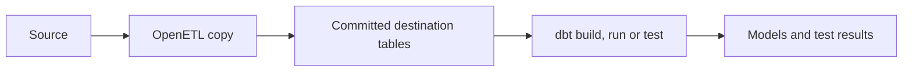

Add a dbt step when you want to build or test models after OpenETL loads data. The runner executes your project against the pipeline's Postgres destination. dbt steps support scheduled pipelines only.

The copied data commits before dbt starts. A failed model or test fails the sync, but the copied data remains in the destination.



## Prepare the runner and destination

You need:

- A Postgres destination and the [official Postgres connector](https://github.com/openetl-io/openetl-connectors/blob/main/postgres/README.md).
- A destination DSN with one host and an explicit user. Both connection URLs and libpq keyword/value strings are accepted.
- Permission for that user to read the loaded tables and create or update the dbt target schema and models.
- `dbt-core` and `dbt-postgres` installed on every runner that can receive the step, including job pods.

For a source-build runner, install dbt in a virtual environment. From the repository root:

```sh
python3 -m venv .openetl/dbt-venv
.openetl/dbt-venv/bin/python -m pip install dbt-core==1.12.6 dbt-postgres==1.11.0
.openetl/dbt-venv/bin/dbt --version
export OPENETL_DBT="$PWD/.openetl/dbt-venv/bin/dbt"
```

These are the versions used by the repository's end-to-end CI. The export sets the executable's absolute path for a runner you start from this shell. The equivalent flag is `--dbt`. Without either setting, the runner finds `dbt` on its `PATH`.

The executable runs inside the runner's environment. A dbt installation on the CLI's computer is insufficient when runners are on other machines.

## Prepare the project

Use [`examples/dbt`](../../examples/dbt) as a working project. Its [`dbt_project.yml`](../../examples/dbt/dbt_project.yml) names the project and profile:

```yaml
name: faker
version: "1.0"
config-version: 2
profile: faker
models:
  faker:
    +materialized: table
```

The profile name must be plain text. OpenETL creates that profile for each step. Your local `profiles.yml` is not uploaded.

Use `OPENETL_NAMESPACE` to locate the tables that OpenETL loaded. From the example's [`sources.yml`](../../examples/dbt/models/sources.yml), with comments omitted:

```yaml
version: 2
sources:
  - name: faker
    schema: "{{ env_var('OPENETL_NAMESPACE') }}"
    tables:
      - name: users
      - name: purchases
```

The [`spend_per_user` model](../../examples/dbt/models/spend_per_user.sql) reads purchases through `source('faker', 'purchases')`. It removes repeated purchase IDs before calculating totals.

If your project uses packages, resolve them before applying it. Include the installed `dbt_packages/` directory. Runners do not run `dbt deps`.

The CLI excludes hidden files, root `target/`, root `logs/` and root `profiles.yml` when packaging the project. Symlinks and other nonregular files are refused. The archive must fit within 16 MiB compressed and 256 MiB unpacked, with at most 20,000 files.

## Attach the project to a pipeline

The complete document is [`examples/faker-to-postgres-dbt.yaml`](../../examples/faker-to-postgres-dbt.yaml). These parts register the project and select its step:

```yaml
apiVersion: openetl.io/v1alpha1
kind: DbtProject
metadata:
  name: faker-dbt
spec:
  path: dbt
```

```yaml
postSync:
  - dbt:
      project: faker-dbt
      schema: faker_marts
```

`path` is relative to the file that contains the `DbtProject`, so this example packages `examples/dbt`. A document read from standard input resolves relative paths from your current directory.

The project and pipeline must belong to the same workspace. API clients supply an encoded bundle instead of `path`. See the [dbt project reference](../reference/specs/dbt-project.md).

## Check the connection and apply

For this example, first store the destination DSN under `local-postgres-dsn`. Use [Manage connection secrets](../self-host/secrets.md) to create it.

From the repository root:

```sh
openetl plan -f examples/faker-to-postgres-dbt.yaml
openetl apply -f examples/faker-to-postgres-dbt.yaml
openetl check destination local-postgres
openetl syncs faker-to-postgres-dbt
openetl logs -f faker-to-postgres-dbt
```

Applying a new scheduled pipeline starts its first sync. Wait for that sync to finish before requesting another one.

After it succeeds, connect to the destination with your SQL client and check the model:

```sql
select user_id, purchases, spend
from faker_marts.spend_per_user
order by user_id
limit 10;
```

Check the model's values as well as the sync state. The sync log includes dbt output and a `dbt finished` entry with node counts.

## Choose the command and target schema

The default command is `build`. Use `run` to run models or `test` to run tests. `select` and `exclude` pass space-separated selectors to dbt. The [pipeline reference](../reference/specs/pipeline.md#steps-after-a-sync) lists these fields.

The generated profile has one target, named `openetl`, with four threads. It uses the destination's host, database, user, password and supported TLS settings.

Keep these schemas separate in your project:

| Setting | Purpose |
|---|---|
| `destination.namespace` | The schema that receives copied tables. The runner exposes it as `OPENETL_NAMESPACE`. |
| `postSync[].dbt.schema` | The dbt target schema. It defaults to the copied tables' schema. Your project's schema-generation rules still apply. |

OpenETL supplies connection values through environment variables used by the generated profile. It does not pass arbitrary runner environment variables to dbt. The inherited variables are `PATH`, `HOME`, `TMPDIR`, `TZ`, `LANG`, `SSL_CERT_FILE` and `SSL_CERT_DIR`.

## Update and recover

Apply the project again after changing its files. A project update creates new dependent pipeline versions. A sync already started keeps its pinned project version.

Steps run in list order. A failed step prevents later steps from running. A dbt command failure reports `DBT_FAILED`; OpenETL does not retry that command automatically.

| Symptom | Action |
|---|---|
| dbt cannot start | Check the runner's `OPENETL_DBT`, executable permissions and installed adapter. |
| Profile or project error | Supply a plain profile name and resolve packages before applying the project. |
| A source table is missing | Check the loaded namespace, stream selection and the model's `sources.yml`. |
| Schema permission error | Give the destination user the permissions needed by the selected materializations. |
| A model or test fails | Read its full message in the sync log. Correct the project and apply it again. |

After a repair, request a new sync:

```sh
openetl sync faker-to-postgres-dbt
```

This starts a complete sync. There is no CLI operation that reruns only its failed dbt step. Account for the pipeline's write mode when another sync can append the same source rows.

When you finish the example, pause the pipeline:

```sh
openetl pause faker-to-postgres-dbt
```

The copied tables and dbt models remain available for inspection.
