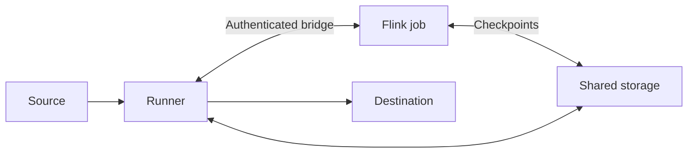

Use a Flink transform when a continuous pipeline needs a streaming application between its source and destination. Your job reads OpenETL streams, processes them and sends outputs back to the runner. OpenETL commits those outputs to the destination with the job's checkpoints.

You provide the Flink cluster. A `FlinkCluster` resource registers a deployment target; it does not install Flink or the Flink Kubernetes Operator.

## Prepare the cluster

Use Flink 1.20. The example builds against Flink 1.20.5 with JDK 17 and Maven 3.9. Choose one deployment target:

| Target | What to prepare |
|---|---|
| `rest` | A running session cluster whose REST API the runner can reach. Optional `rest.auth` names a secret holding a proxy bearer token. |
| `kubernetes` | The Flink Kubernetes Operator, a namespace, an application image and identities that can manage `FlinkDeployment` resources and run the job. |
| `emr` | An existing EMR on EC2 cluster with Flink and a runner identity that can submit and monitor YARN steps. |

For a session cluster, set these options in the cluster's own configuration before starting it:

```yaml
jobmanager.execution.failover-strategy: full
execution.checkpointing.num-retained: 2
```

The runner checks these settings. A per-job `conf` cannot replace them on a session cluster. You can retain more than two checkpoints.

For Kubernetes, job pods need the configured service account and storage access. Kubernetes high availability requires permission to edit ConfigMaps. The default image is `flink:1.20`; include the S3 filesystem plugin when you use S3 storage.

See [Flink cluster](../reference/specs/flink-cluster.md) for all target fields and credentials.

## Connect the job to its runner

Configure both bridge settings on every runner eligible for the pipeline:

| Setting | Purpose |
|---|---|
| `OPENETL_BRIDGE_LISTEN` / `--bridge-listen` | The runner's bridge listen address, for example `:7710`. |
| `OPENETL_BRIDGE_ADVERTISE` / `--bridge-advertise` | The address that Flink uses to reach that same runner, for example `runner-1.internal:7710`. |

Open the bridge port from the Flink JobManager and TaskManagers to the runner. Advertise an address for that individual runner. A load balancer that can choose another runner cannot route the job's bridge connection correctly.

The runner passes the bridge address, a TLS certificate fingerprint and a per-job token in the application's arguments. Pass those arguments to `OpenEtl.fromArgs`. Do not replace them or print the token.



## Give both sides access to storage

The runner and Flink must share the data plane's checkpoint storage. Supported locations are S3 and a directory mounted at the same absolute path on every participating process.

Flink stores its code, checkpoints and savepoints under the pipeline's `_flink/` prefix. Give the cluster permission to read, write, list and clean up that prefix. Keep this storage available across restarts.

For a session cluster, configure its filesystem plugins and S3 credentials when the cluster starts. It cannot accept per-pipeline `flinkAccess.keys`. Application deployments can use those keys; EMR can use `flinkAccess.emrRole`. See [storage access fields](../reference/specs/pipeline.md#access-to-the-data-planes-storage).

The runner still needs its own storage access. Credentials available to the runner do not automatically become the cluster's credentials.

## Get the library

Your application depends on `openetl-flink`. Use the version of your OpenETL installation. Each release has the jar, `openetl-flink-VERSION.jar`, as a release file. The jar is not in a Maven repository. Download it, and install it in your local Maven repository:

```sh
curl -fsSLO https://github.com/openetl-io/openetl/releases/download/v{{version}}/openetl-flink-{{version}}.jar
mvn install:install-file -Dfile=openetl-flink-{{version}}.jar \
  -DgroupId=io.openetl -DartifactId=openetl-flink -Dversion={{version}} -Dpackaging=jar
```

Your project then depends on `io.openetl:openetl-flink:{{version}}`, and on Flink's runtime with `provided` scope. The release's `checksums.txt` has the jar's SHA-256. [Install by hand](../get-started/install.md#install-by-hand) shows how to check a file against it.

The release's jar holds its own dependencies, relocated. Do not add them to your project: [`examples/flink-transform`'s `pom.xml`](../../examples/flink-transform/pom.xml) excludes them.

## Build a job

[`examples/flink-transform`](../../examples/flink-transform) is a Maven project that forwards each input stream to an output of the same name. It exercises the bridge and checkpoint contract without changing rows.

Get the release's source, and package the example with the library that you installed:

```sh
git clone --depth 1 --branch v{{version}} https://github.com/openetl-io/openetl
cd openetl
mvn -f examples/flink-transform/pom.xml package -Dopenetl.version={{version}}
```

The application jar is `examples/flink-transform/target/flink-transform-0.1.0.jar`. It includes `openetl-flink` and its relocated dependencies. Flink runtime dependencies have `provided` scope and come from the cluster.

To build the library from the checkout instead, run `mvn -f libs/openetl-flink/java/pom.xml install`. Then package the example without `-Dopenetl.version`.

The [`ForwardStreams` class](../../examples/flink-transform/src/main/java/io/openetl/examples/ForwardStreams.java) creates an execution environment, then calls:

```java
OpenEtl openetl = OpenEtl.fromArgs(environment, args);
for (String name : openetl.streamNames()) {
  openetl.sink(name, openetl.stream(name));
}
environment.execute("OpenETL forward streams");
```

For your own transformation, read streams with `stream(NAME)` and send output rows to `sink(OUTPUT, ROWS)`. Use `rowType(NAME)` to inspect an input's `RowType`. Use `outputNames()` to inspect the allowed outputs.

Rows are Flink `RowData`. CDC operations become `RowKind`: insert, update-after or delete. `_openetl_op` is represented by that row kind rather than a field. Preserve changelog behavior when adding operators.

The output DataStream needs `InternalTypeInfo` for its `RowType`. When you change a row schema, supply matching type information or use the sink overload that accepts an explicit `RowType`.

OpenETL reads every selected input stream, including streams your application does not use. Select inputs in the pipeline. Every output your job writes must be declared by the pipeline.

## Publish and configure the pipeline

Put the application jar at an `https://`, `s3://` or `s3a://` URI that the runner can read. The runner reads an `s3://` URI with the same credentials and query parameters as its own bucket. See [Buckets](../self-host/index.md#buckets). Calculate the jar's digest:

```sh
shasum -a 256 examples/flink-transform/target/flink-transform-0.1.0.jar
```

Copy [`examples/faker-flink-to-parquet.yaml`](../../examples/faker-flink-to-parquet.yaml) and edit it for your installation. It uses an endless built-in faker source and the built-in Parquet destination. Its transform is:

```yaml
transform:
  flink:
    cluster: example-flink
    parallelism: 1
    code:
      jar: https://artifacts.example.com/flink-transform-0.1.0.jar
      sha256: "0000000000000000000000000000000000000000000000000000000000000000"
      class: io.openetl.examples.ForwardStreams
```

Replace the example URI and zero digest with your published jar and its actual SHA-256. Set the cluster's REST URL and the destination's output path. The output path is on the runner's filesystem.

Flink transforms require `mode: continuous`. Every input must replay exactly from a saved position. The plan rejects inputs that cannot meet this requirement.

Omitting `outputs` keeps the input stream names and settings. Declare output names and primary keys when you rename streams or change their write behavior. See [transform fields](../reference/specs/pipeline.md#transforms).

## Apply and verify commits

After editing the example:

```sh
openetl plan -f examples/faker-flink-to-parquet.yaml
openetl apply -f examples/faker-flink-to-parquet.yaml
openetl discover flink-data
openetl syncs faker-flink-to-parquet
openetl logs -f faker-flink-to-parquet
```

The pipeline starts a continuous run. Following its log continues until you interrupt the CLI or the run ends.

The example sets `endless: true` on faker so it supports streaming reads. If the first plan had no discovery result, repeat it after discovery to inspect input replay requirements.

Check all three observations:

1. The job is running in Flink and has completed checkpoints.
2. OpenETL's last commit time advances and committed row counts increase.
3. Destination files contain records from `users` and `purchases`.

Job state alone is insufficient. A running job can have a checkpoint, bridge or destination failure that prevents commits.

## Preserve state during recovery

OpenETL coordinates Flink checkpoints with destination commits. It sets checkpoint locations, checkpoint mode, restart behavior and deployment identity. Do not override the reserved options listed in the [pipeline reference](../reference/specs/pipeline.md#transforms).

Keep your stateful operators' identifiers and state schemas compatible across application updates. Publishing a new jar does not migrate incompatible Flink state. Update the pipeline's URI and digest together, then review the plan before applying.

To stop the example, request a pause and wait for its run to stop:

```sh
openetl pause faker-flink-to-parquet
openetl syncs faker-flink-to-parquet
```

Use OpenETL to manage the pipeline's lifecycle so it can coordinate the Flink job and destination. Do not remove checkpoint files as a repair step.

`reset` and `rewind` are unavailable for pipelines with Flink transforms. Flink state must correspond to the source positions. If you need to start over, plan a new pipeline and its destination behavior before removing the old one.

## Diagnose failures

| Symptom | Action |
|---|---|
| The runner serves no bridge | Configure both bridge settings on the runner that receives the pipeline. |
| The job cannot connect to the bridge | Test routing from JobManager and TaskManagers to the advertised runner address. Check that it reaches the correct runner. |
| Session configuration is refused | Set full failover and at least two retained checkpoints in the cluster's startup configuration. |
| Checkpoint storage cannot be read | Check filesystem plugins, credentials and directory mounts on every Flink process. |
| A stream cannot replay exactly | Choose a source mode and connector with exact resume behavior, or use a scheduled Spark pipeline where appropriate. |
| The sink rejects a row type | Supply the correct `RowType` and `InternalTypeInfo`; preserve changelog row kinds. |
| A job repeatedly fails | Read the application exception in Flink and the pipeline log. Repair the cause before resuming a paused pipeline. |

Flink can recover task failures within a run. A terminal application failure reports `FLINK_FAILED` and fails the run. Correct the code or configuration and apply the change to start a new run. Resume the pipeline if an incident paused it. Use [Troubleshoot a pipeline](../pipelines/troubleshooting.md) to inspect attempts and incidents.
