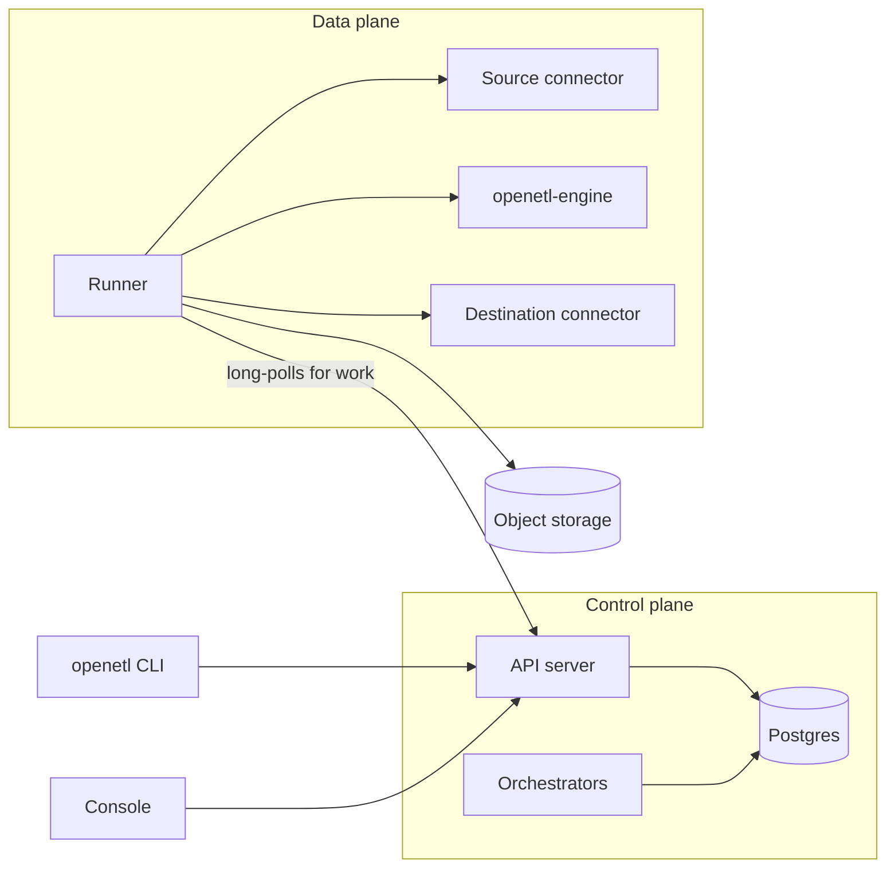

This page describes the main components for contributors. [Self-host](../self-host/index.md) covers installation.

## The parts

[`internal/daemon`](../../internal/daemon) runs the roles of the `openetld` program. `server` serves the API and console. `orchestrator` executes workflows and assigns jobs. `runner` executes attempts. `dev` combines all three roles in one process.

## The API

[`internal/api`](../../internal/api) serves the API defined in [`proto/openetl/api/v1`](../../proto/openetl/api/v1) over Connect, gRPC, gRPC-Web and REST. Vanguard transcodes the REST routes from `google.api.http` rules. These rules also generate `internal/api/openapi.yaml`.

The CLI and console use this API. [`internal/webui`](../../internal/webui) serves the built console from the same origin.

Runners call `DataPlaneService`, defined in [`proto/openetl/dataplane/v1`](../../proto/openetl/dataplane/v1). A runner token limits each runner to its data plane's work. [`internal/auth`](../../internal/auth) manages API keys, runner tokens and roles.

## The metadata store

[`internal/store`](../../internal/store) is the metadata database, on Postgres: its goose migrations, and the queries from which sqlc generates `internal/store/db`. Every query outside the `orgs` table is scoped by `org_id`, which `TestQueriesAreOrgScoped` checks.

[`internal/secrets`](../../internal/secrets) encrypts secret values before storage. Each organization has a data key that encrypts values with AES-256-GCM. The installation's local or KMS key wraps those data keys.

Secrets can also reference AWS Secrets Manager, GCP Secret Manager or Azure Key Vault. Runners resolve these references with their cloud identity through [`internal/secretstore`](../../internal/secretstore).

## Orchestration

Workflows manage schedules, continuous-pipeline supervisors, syncs and operations such as source discovery. They use the interface in [`internal/orchestration`](../../internal/orchestration). The default DBOS backend stores workflow state in Postgres. Temporal is the other supported backend.

Steps perform I/O; workflow code does not. After a failure, workflow replay returns the recorded results of previous calls. Workflow code therefore cannot use its own clocks, randomness or goroutines. Changes that alter an existing workflow's execution path require `Context.Version`.

[`internal/orchestration/dispatch`](../../internal/orchestration/dispatch) sends work to data planes through the API. It uses Postgres dispatch records, leases and long polling to deliver results to waiting workflows. `sizing` selects the resources for the next attempt. `scaling` adjusts continuous jobs when their lanes need more or fewer resources.

## Runners

A runner ([`internal/runner/worker`](../../internal/runner/worker)) registers with the API, polls for work, executes it and reports results. Each attempt goes to a runner in the pipeline's data plane and pool with sufficient capacity. A [pod launcher](../../internal/runner/pods) can instead create a Kubernetes pod for one attempt. That pod runs `openetld runner` and obtains the attempt from the API. [Install on Kubernetes](../self-host/kubernetes.md) explains sizes, pools and placement.

An attempt ([`internal/runner`](../../internal/runner)) hosts connectors, drives dataflow and coordinates checkpoints. Built-in connectors run inside the runner. External connectors run as separate processes and serve the connector protocol on Unix sockets. [`internal/connectorhost`](../../internal/connectorhost) supplies host services, including HTTP retries and secrets.

## Around the data path

- **Incidents** ([`internal/heal`](../../internal/heal)) are opened and resolved, and their playbooks run, in the same transaction as the report that shows them.
- **Platform events** ([`internal/events`](../../internal/events)) enter an outbox in the transaction that changes the reported resource. [`internal/webhooks`](../../internal/webhooks) delivers them with Standard Webhooks signatures.
- **Outbound connections** go through [`internal/netguard`](../../internal/netguard), which checks every address after DNS resolution, against server-side request forgery.
- **Transforms** run on the user's clusters. [`internal/spark`](../../internal/spark) runs Spark applications. [`internal/flink`](../../internal/flink) runs a continuous pipeline's Flink job. [`libs/`](../../libs) contains the cluster-side libraries.
