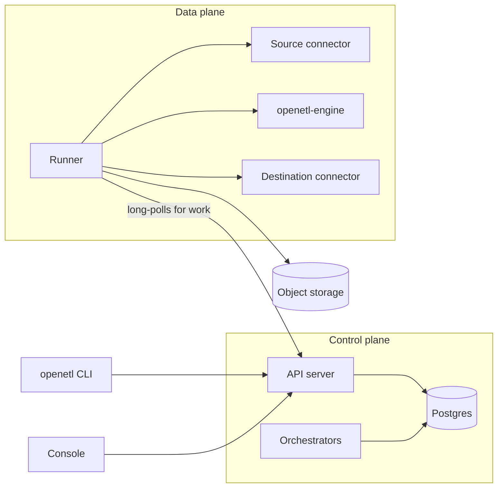

This page explains how OpenETL applies pipeline definitions, executes jobs and commits data. It identifies the packages responsible for each operation. [CONTRIBUTING.md](../../CONTRIBUTING.md) explains how to build and test the code.

## The parts

[`internal/daemon`](../../internal/daemon) runs the roles of the `openetld` program. `server` serves the API and console. `orchestrator` executes workflows and assigns jobs. `runner` executes attempts. `dev` combines all three roles in one process.

## The API

[`internal/api`](../../internal/api) serves the API defined in [`proto/openetl/api/v1`](../../proto/openetl/api/v1) over Connect, gRPC, gRPC-Web and REST. Vanguard transcodes the REST routes from `google.api.http` rules. These rules also generate `internal/api/openapi.yaml`.

The CLI and console use this API. [`internal/webui`](../../internal/webui) serves the built console from the same origin.

Runners call `DataPlaneService`, defined in [`proto/openetl/dataplane/v1`](../../proto/openetl/dataplane/v1). A runner token limits each runner to its data plane's work. [`internal/auth`](../../internal/auth) manages API keys, runner tokens and roles.

## The metadata store

[`internal/store`](../../internal/store) is the metadata database, on Postgres: its goose migrations, and the queries from which sqlc generates `internal/store/db`. Every query outside the `orgs` table is scoped by `org_id`, which `TestQueriesAreOrgScoped` checks.

[`internal/secrets`](../../internal/secrets) encrypts secret values before storage. Each organization has a data key that encrypts values with AES-256-GCM. The installation's local or KMS key wraps those data keys.

Secrets can also reference AWS Secrets Manager, GCP Secret Manager or Azure Key Vault. Runners resolve these references with their cloud identity through [`internal/secretstore`](../../internal/secretstore).

## Orchestration

Workflows manage schedules, continuous-pipeline supervisors, syncs and operations such as source discovery. They use the interface in [`internal/orchestration`](../../internal/orchestration). The default DBOS backend stores workflow state in Postgres. Temporal is the other supported backend.

Steps perform I/O; workflow code does not. After a failure, workflow replay returns the recorded results of previous calls. Workflow code therefore cannot use its own clocks, randomness or goroutines. Changes that alter an existing workflow's execution path require `Context.Version`.

[`internal/orchestration/dispatch`](../../internal/orchestration/dispatch) sends work to data planes through the API. It uses Postgres dispatch records, leases and long polling to deliver results to waiting workflows. `sizing` selects the resources for the next attempt. `scaling` adjusts continuous jobs when their lanes need more or fewer resources.

## Runners

A runner ([`internal/runner/worker`](../../internal/runner/worker)) registers with the API, polls for work, executes it and reports results. Each attempt goes to a runner in the pipeline's data plane and pool with sufficient capacity. A [pod launcher](../../internal/runner/pods) can instead create a Kubernetes pod for one attempt. That pod runs `openetld runner` and obtains the attempt from the API. [Install on Kubernetes](../self-host/kubernetes.md) explains sizes, pools and placement.

An attempt ([`internal/runner`](../../internal/runner)) hosts connectors, drives dataflow and coordinates checkpoints. Built-in connectors run inside the runner. External connectors run as separate processes and serve the connector protocol on Unix sockets. [`internal/connectorhost`](../../internal/connectorhost) supplies host services, including HTTP retries and secrets.

## The engine

[`openetl-engine`](../../crates/engine) is the Rust data engine. The runner starts one engine process per job and communicates through two socket types. The control channel uses `EngineService` from [`proto/openetl/engine/v1`](../../proto/openetl/engine/v1). Data edges carry frames with a 12-byte header and Arrow IPC payload.

The runner sits between the connectors and the engine. Its source pump is the source connector's emitter, and sends what the source reads to the engine's inbound edges. On each lane, the engine:

- turns raw rows into Arrow, inferring each stream's schema from what it sees and only ever widening it, and coerces values to the types a source declares ([`crates/normalize`](../../crates/normalize));
- sets aside the records it can't take, with a reason, as JSON lines under the pipeline's `_quarantine/` in object storage;
- applies the pipeline's schema policy, gives tables and columns their destination names, which never change once given, and adds the metadata columns, `_openetl_id` among them;
- holds back the columns and cells the destination can't take, and keeps their values for a later release;
- hands the rows to writer lanes, which write to the runner, with barriers in band, or stage Parquet files, for a destination that loads them and for the built-in `parquet` destination.

The runner's sink pumps hand each writer lane's batches to the destination connector's writer.

### Partitioning and exchanges

[`internal/plan`](../../internal/plan) plans each stream's path from its source to the destination's writer. Each edge of the path has a partitioning: how its rows are spread over the lanes of the operator it feeds. A source's stream is split by its primary key where the catalog says that its splits partition it by key (`splits_by_key`), unless it is read with `cdc`, and is unpartitioned otherwise. Each operator states what it needs of its input. The writer of a keyed stream needs its primary key, so that one writer lane gets all of a key's rows. A statement's need comes from the engine's plan of it (`need`), and a row-wise statement needs nothing.

An exchange by key group is placed only before an operator whose need its input does not meet. A partitioning by columns `K` meets a need for columns `J` when `K` is a subset of `J`. So an operator that exchanged rows by its keys `k` feeds a writer that needs `(window_start, k)` with no second exchange. A statement keeps a partitioning while its columns pass through unchanged, renamed or not (`passes` in the engine's plan of it); otherwise its output is unpartitioned. A destination with one writer lane takes every lane's rows, which meets every need.

The same plan gives `openetl plan` its `partitioning` section, and the runner the exchanges of each attempt (`StreamPlan.exchange` in `StartJob`). With one writer lane, the runner sends none. The engine sends each row of a stream with an exchange to the writer lane that owns the key group (`openetl.kg.v1`) of its values of the exchange's columns, which must be of the stream's primary key. On workers, that writer lane may be another engine's, as [the exchange between engines](#the-exchange-between-engines) describes.

Lanes and writer lanes own contiguous ranges of the pipeline's key groups, picked together ([`crates/engine/src/layout.rs`](../../crates/engine/src/layout.rs), and `plan.NewLayout` for the runner). Writer lane `w` owns the `w`-th of the writer lanes' equal ranges. Each writer lane's range is cut again among the lanes that feed it, in lane order: each writer lane gets one lane, and each other lane goes to the writer lane with the most key groups per lane. A lane without an exchange writes to the writer lane whose range holds its own. An attempt has no more lanes than key groups.

### Watermarks

A stream that a SQL transform reads can have event time (`StreamPlan.event_time`). For such a stream, the runner's source pump gives each split a lane as the read starts, and the split joins that lane with a `SPLIT` frame before anything else of the stream. The frame carries the watermark the attempt starts the split at. A split that another split adds joins that split's lane. Before a batch of another split than the last one, the runner sends a `SPLIT` frame that names it. The pump also sends `SPLIT` frames to raise a split's watermark: when the split is idle in a continuous read, and when it completes. These go through the pump as the split's events, so a split that waits at a barrier has them sent after the lane's barrier.

[`crates/engine/src/watermark.rs`](../../crates/engine/src/watermark.rs) has the two halves. `Splits` is a lane's splits of one stream: each split's watermark is the latest event time it has read less the delay, or what its `SPLIT` frames raise it to, and the lane's is the least of them. The splits a read starts with join together, so a restore never starts a lane above one of its splits. `Senders` is whatever takes a stream from several senders: it starts at the stream's floor, the least watermark of the attempt's splits, and takes the least of every sender, counting each one from the start. A sender's watermark never goes back.

On a lane, each advance reaches the statements that read the stream through `Stage::watermark`, after the batch that moved it, and then goes to the writer lanes in the outputs' `Out::Watermark`, as barriers do. A writer lane aligns a watermark with the barriers as it aligns rows. So, at a barrier, it has the least watermark that each lane had at its own barrier. At each barrier of the stream, a lane reports its splits' watermarks, which `EpochReady.watermarks` carries to the runner, and the checkpoint record keeps with each split. A worker's share carries them in its `EpochReady`.

### Keyed state

[`crates/state`](../../crates/state) is the state layer for stateful operators. The group window operator uses it ([Group windows](#group-windows)).

Operators reach state through one trait, `StateBackend`, which has four primitives: a value per key, rows per key by the time they fall due, a set with expiry, and timers. Each call names the operator and the key's group. A lane opens one `Layer` for its range of key groups, and all operators of the lane share it.

The layer keeps the open epoch's changes in memory. At a barrier, it commits them to a store, which returns the snapshots that the checkpoint record names. If the epoch fails, the layer discards its changes. A restore opens only the snapshots that a record names, for any range of the pipeline's key groups. So the state of a key group can move to another lane, or to another worker.

Keys start with their key group, so a range of key groups is a range of keys. In each key group, rows sort by the time they fall due, so the rows that a watermark releases are one range. Timers sort by time across the lane's key groups, so a restore reads no timer before it is due.

The engine's only store keeps every version in the memory of the process ([`crates/engine/src/state.rs`](../../crates/engine/src/state.rs)), with a bucket for each operator of each pipeline. A record names its versions as `memory:` URLs. Nothing in it survives the process, and each attempt runs its own engine process, so a restore finds the state only within the process that wrote it. A keyed lane releases all but its newest two versions after each barrier.

### Group windows

A statement whose `GROUP BY` has a window plans as a `GroupWindow` ([`crates/sql/src/window.rs`](../../crates/sql/src/window.rs)): the row-wise steps before it, the window, the group keys, the aggregates, and the steps after it. Its operator ID hashes what its state means: the stream it reads, the steps, the window, the keys, the aggregates and the state's layout. A change to any of them gives a new ID, which restores no state.

The statement runs on keyed lanes, past an exchange inside the engine ([`crates/engine/src/dataflow/keyed.rs`](../../crates/engine/src/dataflow/keyed.rs)). Each lane sends each row of the stream to the keyed lane that owns the key group of the row's group keys, by the layout's lane ranges. It sends its barriers, its watermark advances and its end to every keyed lane. A keyed lane aligns its senders at each barrier, as a writer lane does. Its range of key groups lies within one writer lane's range, so its output reaches that writer lane with no second exchange. A keyed lane opens a `Layer` for each group window it runs, on a store of the window's own.

A keyed lane's watermark is the least of its senders' watermarks, through `Senders`, starting at the stream's floor. A lane's watermark advance comes after the rows that moved it. At open, a keyed lane advances its windows to the floor, so a window that closed before the checkpoint, or before the read that the floor carries over, stays closed. Each advance fires the timers it reaches: a window gives its row, and its state stays until the watermark passes its end plus the lateness. The keyed lane then sends the watermark to its writer lane as the output's.

[`crates/engine/src/window`](../../crates/engine/src/window) is the operator. A window's state is its accumulators and how many times its row has been given, under its group keys and start. A session's state is every session of its keys. Each output row has an `_openetl_id` and a seq from its key and that count, so a replay gives the same rows.

## Checkpoints

[`internal/checkpoint`](../../internal/checkpoint) keeps each pipeline's checkpoint log under `{org}/{pipeline}/_checkpoints/` in object storage. Records are immutable, and `HEAD` points to the latest record. Compare-and-swap updates use conditional writes on S3, GCS and Azure Blob Storage. This prevents two attempts from advancing the same `HEAD` concurrently.

An attempt claims the pipeline by writing `HEAD` with the next generation. An older active attempt, called a **zombie**, receives `ErrFenced` on its next `HEAD` write and stops. Each record contains stream resume states and schemas, lane committables, and staged or quarantined file references.

The same storage holds, next to the log, each attempt's log as JSON lines (`_logs/`), staged epochs (`_staging/`), held values (`_held/`) and quarantined records (`_quarantine/`).

## The commit protocol

Data is committed in **epochs**: the records between two checkpoints. For each one:

1. The coordinator requests barrier N. The source pump inserts it after each split's next resume point. This aligns the barrier with a position the source can resume from.
2. The barrier travels through the engine to each writer lane. After all its streams cross the barrier, each lane calls `PreCommit(N)` and returns a committable. The lane's data is durable. Stage-and-apply and transactional destinations keep it invisible until commit; deliver-and-acknowledge destinations have already delivered it.
3. The coordinator writes record N to the checkpoint log and moves `HEAD` to it. This is the commit point.
4. Lane 0's writer calls `Commit(N)` with every lane's committable. Stage-and-apply destinations make the epoch visible with stream markers protected by the destination fence. Commit is idempotent and can be retried. If retries fail, the next attempt's `Recover` applies the epoch from its recorded committables. A destination with lane commits is different: each lane's writer commits its own committable, as [Attempts on workers](#attempts-on-workers) describes.
5. The source receives the positions it can acknowledge upstream, such as event offsets or a replication position. This notification is one checkpoint behind.

Commits run one at a time, in epoch order, while barriers for later epochs go on being placed.

After claiming the pipeline, an attempt calls its writer's `Recover`. This raises the destination fence to the new generation, preventing zombie commits. It then checks the epoch referenced by `HEAD`.

The epoch can be already applied, recoverable from its committables, or lost. If it is lost, the log returns to the preceding record. The attempt reads from the resume states in the selected record. A record of a destination with lane commits, written on workers, is settled lane by lane instead, and is never rolled back; [Attempts on workers](#attempts-on-workers) describes how.

A delayed split can use a forced barrier without a resume point only when replay preserves the required delivery guarantee. Recovery from that checkpoint reads some records again. The [`test/sim`](../../test/sim) simulation exercises the protocol.

## Attempts on workers

An attempt can run on several runners: one runner coordinates it, and the others, its workers, run its lanes. They use the attempt protocol, `openetl.attempt.v1` ([`internal/runner/attempt`](../../internal/runner/attempt)). Each worker opens one call to the coordinator. The coordinator claims the pipeline, writes the records and decides when each epoch commits. It reads and writes no data. It starts the source and destination connectors, with their credentials, only to set them up and discover the streams. It then keeps the destination's capabilities and stops the connectors before the workers start, and the workers skip the connectors' setup. The attempt runs this way:

- Before the coordinator assigns work, the first worker opens the attempt's first writer lane. It raises the destination fence and settles the epoch that `HEAD` points to, as the recovery of a single runner does, unless the epoch is settled lane by lane, as described below. It also gets the splits of the reads that start.
- Each worker reads its splits with its own source connector and runs its own engine. It writes its writer lanes with its own destination writers.
- All the splits of these streams go to one worker:
  - a stream written with overwrite;
  - a stream that the attempt does not read;
  - a stream read with `cdc`, and every such stream goes to the same worker: a source reads their changes from one log, such as a Postgres replication slot, which only one read can hold.

  With a SQL transform, a stream that a statement reads goes to one worker if it is read with `cdc`, or an output written from it, or the stream passed through, is written with overwrite. A keyed stream whose splits do not keep a key's rows together has an exchange on its path, which crosses workers, as [the exchange between engines](#the-exchange-between-engines) describes; a dataflow that cannot exchange between engines (`runner.Meshing`), such as the runner's tests' `Passthrough`, keeps such a stream on one worker.
- A worker sends its share of each epoch when its part is durable. The share holds its splits' positions, its rows, its committables and what its engine reported. The coordinator merges the shares into one record. The record also has each committable's coverage: the splits whose rows it holds, where each split's part of the epoch began, how many rows the split had, and the key groups of those rows with the key that grouped them. With a SQL transform, the coverage names a split of a stream that a statement reads once for each output whose rows of it the committable holds (`CoveredSplit.output`): every row of an output without an exchange, where the split's lane fed the committable's writer lane, and the writer lane's key groups of an output with one, by the output's key, whichever lane read the split.
- After the record, the first worker applies schemas and commits at the coordinator's request. A destination with lane commits (`DestinationCapabilities.lane_commits`) is different: each worker commits its own writer lanes, each with its own committable. The coordinator then sends the record's positions to the workers. Each worker acknowledges only the positions of its own splits, one checkpoint behind.
- Each stream's schema has one owner, the coordinator. An engine whose lane changes a schema proposes the change from the version that it has. Integers past ±2^53 in a column are such a change too, because a later float then makes the column text. Every engine shapes by the versions that the coordinator accepts. Lanes of one engine share these changes through the engine's own owner of the stream, which follows the coordinator's versions.
- A version of one of the destination's streams also holds the columns that the stream holds whole, and the schema that the destination gets (`SchemasResponse.holding` and `delivered`). An engine that starts a column hold proposes it as a change, so the first decision is every worker's. The coordinator records the owner's columns and delivered schema, and adds up the workers' held cells and files. Each engine names its held files by the attempt's index of its writer lanes, so the workers' files do not collide.
- With a SQL transform, the streams that the statements read have versions of their own (`SchemasRequest.input`). An engine proposes what its lanes typed that the owner's version lacks: new columns, and types that hold the owner's. The record keeps the owner's schema of each input and of each output.
- The coordinator starts the holds as a single runner does: from the restored record, with the job's releases, and with the columns that the destination refused. It sends them in the assignment (`Assignment.holds`), and the first worker's `Recover` answer gives it the destination's table limits. Only the engine with the attempt's lane 0 patches in released holds. A refusal ends the attempt, and the coordinator claims the pipeline again at once with the refused columns held. The same worker pods join the newer generation.
- A lost worker or a lost coordinator fails the attempt. The next attempt restores every worker from the record, in a new layout.

With lane commits, an epoch can be committed in part, so the next attempt settles the restored record committable by committable ([`internal/runner/redo.go`](../../internal/runner/redo.go)). The coordinator sends each worker a `Settle` call before it assigns any work. Committables whose coverage shares a split go to the same worker. While the coordinator waits for any call's answer, its heartbeats say so (`Heartbeat.calling`), and a worker without its assignment goes on waiting for it. For each committable, the worker opens a writer as the lane that staged it, and its `Recover` fences that lane. The committable then ends one of three ways:

- The writer finds the lane's marker, so the lane is applied.
- The writer commits the lane's staging, if the lane kept one.
- The writer reports it lost. The worker then reads each covered split again, on a read of its own that does not follow the source, from where its part of the epoch began, with the record's state for the split as its `until` unless the split completed in the epoch. The read stops at the resume point that the record has for the split, or at a completion at the state that the record has. It fails with `POSITION_LOST` if it ends first, ends elsewhere, or returns fewer rows than the coverage counts, unless the split's barrier was forced. The coverage also names the primary key of a stream split by key group; under another key, the redo fails with `CONFIG_INVALID`. The worker sends the rows through an engine that keeps only the committable's key groups, writes them as that epoch's on the writer, and commits them.

  With a SQL transform, the engine runs the statements on the rows read again, and keeps of each output the committable's key groups, where the coverage names them. Splits that reach the committable through different sets of outputs, such as one whose lane fed the writer lane and one that only an exchange brought there, are read on different lanes of the engine, each writing a writer lane of its own with no exchange. The runner drops each lane's rows of the outputs the coverage does not name for its splits, and passes each stream's barrier on once every lane has passed it. The record keeps the SHA-256 of the statements that wrote the epoch (`sql_digest`), and other statements fail the redo with `CONFIG_INVALID`: they could write other rows than the epoch's other lanes committed. So does an output that the SQL no longer writes from the same stream, and, where the coverage names an output's key groups, a key other than the one that grouped them.

A single runner settles such a record the same way. On one runner, a destination with lane commits gets one writer lane, and a record without coverage is recovered whole, as before. Resplitting is off for such a destination, because a split added during an epoch cannot be read again as it was.

These jobs run on one pod:

- a job with a Spark or Flink transform;
- a job whose destination loads staged epochs or is written by the engine;
- a job whose destination is transactional and does not have lane commits;
- a job whose destination takes fewer writer lanes than there are workers;
- a job with a SQL statement that keeps state, as a group window: its keyed lanes take the stream from every lane of the attempt in one engine, which keeps the state in its memory. The engine refuses such a statement in a part of an attempt.

`plan.OnePod` ([`internal/plan`](../../internal/plan)) is the one check behind these cases, for the plan, for `EnqueueWork` and for `Job.OnWorkers`. `EnqueueWork` works out an attempt's workers when it sizes the attempt, so the workflows and their histories do not change. The placer sends an attempt on workers only to a pod launcher of its pool, all of its pods or none, and the launcher's `--max-pods` and `--max-pod-cpu` count every pod. The launcher ([`internal/runner/pods`](../../internal/runner/pods)) makes the workers' pods, then the coordinator's.

The coordinator listens at `--attempt-listen` with a certificate that it makes, claims the pipeline, and makes a token for the attempt. `OpenWorkers` gives the API its address, certificate and token, which the dispatcher keeps in `dispatches.worker_target`. Each worker's pod calls `PollWork` with its index until the API has them, then joins with the token. Workers take no part in the attempt's lease or result. If the coordinator finds that the job cannot run on workers, it reports `one_pod`, and the dispatcher places the same attempt again on one pod.

### The exchange between engines

Where a destination's stream has an exchange and an attempt runs on several workers, the workers' engines exchange rows between them ([`crates/engine/src/mesh.rs`](../../crates/engine/src/mesh.rs)). The coordinator lays the attempt out with `plan.NewWorkerLayout`: the attempt's writer lanes own the key groups' equal ranges, each worker's writer lanes follow the worker before it's, and each worker cuts its own writer lanes' ranges among its lanes as one engine does (`Layout::meshed` in the engine). It caps a worker's lanes at its writer lanes' key groups. `Assignment.lanes[].key_groups` and `writer_lanes[].key_groups` carry the layout, and `Assignment.exchange` a certificate, its key and a secret that the coordinator makes for each generation. The workers' addresses come from their joins (`Join.address`, from `--exchange-listen` and `--exchange-advertise`, or 127.0.0.1 and a free port). Each worker gives its engine `StartJobRequest.mesh`: every engine's address, lanes and writer lanes, where to listen, and the identity.

A lane sends each row of an exchanged stream to the attempt's writer lane that owns its key group, and the stream's schema changes, watermarks, barriers and end to every writer lane of the attempt. A writer lane on another engine gets them over that engine's link: a queue bounded in bytes, an eighth of the job's memory split among the links and at most 8 MiB each, which a lane waits on when it is full, and a connection that writes the queue in order. Each engine dials every other once and listens for them, over TLS 1.3 with AES-128-GCM, pinned to the attempt's certificate. The dialer's first frame is `MeshHello`, with the attempt, the generation, its index and the secret. The listener checks them, refuses another attempt's or generation's, a wrong secret, or an engine already connected, and answers with its own `MeshHello` before it reads any data frame. After the hellos, each `ROUTE` frame names the sending lane and the receiving writer lane of the frames after it, which are the engine's own `BATCH`, `SCHEMA_CHANGE`, `BARRIER`, `WATERMARK` and `END_OF_STREAM` frames. The receiver gives them to its writer lanes as from its own lanes, so a writer lane aligns barriers, and takes its watermark as the least, over every lane of the attempt, connected yet or not. A slow writer lane slows its senders through its channel, the connection's flow control and the link's bound.

An engine fails its job as `TRANSIENT` if it cannot reach another engine in a minute, if another engine does not connect in a minute, if a connection breaks before the other engine's lanes have ended every exchanged stream, or if the other engine refuses it. TCP keepalive finds a dead peer of an idle connection, and on Linux, `TCP_USER_TIMEOUT` one with unacknowledged data. Such a failure carries `PeerLost` in its status, and the worker reports it as `AttendRequest.peer_lost`: the coordinator waits up to 5 seconds for another worker's own failure or loss, which says why, and fails the attempt with that one if it comes. A listener reads a hello of at most 4 KiB, and handshakes with at most 64 connections at once. Each committable's coverage in the record holds its key groups of every split of an exchanged stream that any worker read in the epoch; the coordinator adds the other workers' splits when it merges the shares. A redo of a lane's part reads all of them. A SQL transform's coverage names the splits of the streams it reads, not of the outputs it exchanges, so it gets none of the other workers' splits; only a destination with lane commits reads coverage, and a SQL transform into one runs on one pod.

A frame kind crosses engines once the engine's `mesh::wire` and `mesh::unwire` carry it; a writer lane's feed aligns it per sending lane as it does its own lanes' frames.

## Delivery levels

[`internal/delivery`](../../internal/delivery) works out each stream's guarantee from the destination's class, the source's replay, the write mode, the primary key and the level the pipeline requires:

- An exact source into a stage-and-apply or transactional destination is **exactly once**: the protocol alone keeps every record to one commit.
- A superset source written with merge into a stage-and-apply destination is **effectively once**: a repeat lands on the same key, guarded by `_openetl_seq`, so the table ends up the same.
- A superset source written with append or overwrite into a destination that can skip rows by `_openetl_id` when it applies is exactly once, when the pipeline requires more than at least once.
- A destination that delivers and acknowledges, and anything else, is **at least once**.

[`internal/plan`](../../internal/plan) uses it to plan a pipeline version from its source's latest catalog, and the runner checks again before each sync, against the catalog it discovers.

## Around the data path

- **Incidents** ([`internal/heal`](../../internal/heal)) are opened and resolved, and their playbooks run, in the same transaction as the report that shows them.
- **Platform events** ([`internal/events`](../../internal/events)) are written to an outbox in the transaction that changes what they report, and delivered to webhooks, signed as the Standard Webhooks spec says ([`internal/webhooks`](../../internal/webhooks)).
- **Outbound connections** go through [`internal/netguard`](../../internal/netguard), which checks every address after DNS resolution, against server-side request forgery.
- **Transforms** run on the user's own clusters: [`internal/spark`](../../internal/spark) runs Spark applications, and [`internal/flink`](../../internal/flink) a continuous pipeline's Flink job, with [`libs/`](../../libs) holding what runs on those clusters.

## How it's tested

- **Unit tests** (`make test`) need no Docker.
- **The simulation**, [`test/sim`](../../test/sim), runs the real runner with fake sources and destinations. A seed selects fault timing, failures and zombie attempts. Checks cover data loss, exactly-once duplicates and final rows under effectively-once delivery. Its `workers` kind runs no runner code. It is a model of SQL on several workers, with an exchange by key group. In that model, keyed state is kept as runs on object storage that the checkpoint record names. The model covers the restore of a stateful operator onto other lanes and workers, and the retention of its runs. It also covers the redo of a lost writer lane of a destination with lane commits, with a row-wise output that each lane writes on its own and one that an exchange sends by key group. Each broken variant, chosen with `-broken=NAME`, breaks the protocol in one way. `TestBroken` shows that a check catches each variant. `make sim SEEDS=10000` runs more seeds. `go test ./test/sim -run 'TestSimulation/kafka' -seed=42 -v` replays one seed with its trace.
- **End-to-end tests**, [`test/e2e`](../../test/e2e), run the whole stack against the compose services and the official connectors, one test at a time.
- **The chaos suite**, in `test/e2e`, runs randomized pipelines while runners, engines and connectors die, runners lose the API and the object store fails, and checks every row landed once.
- **Recorded workflow histories**, in `internal/orchestration/workflows/testdata`, replay against the current workflows, so a change that would break a running workflow on Temporal fails a test.
