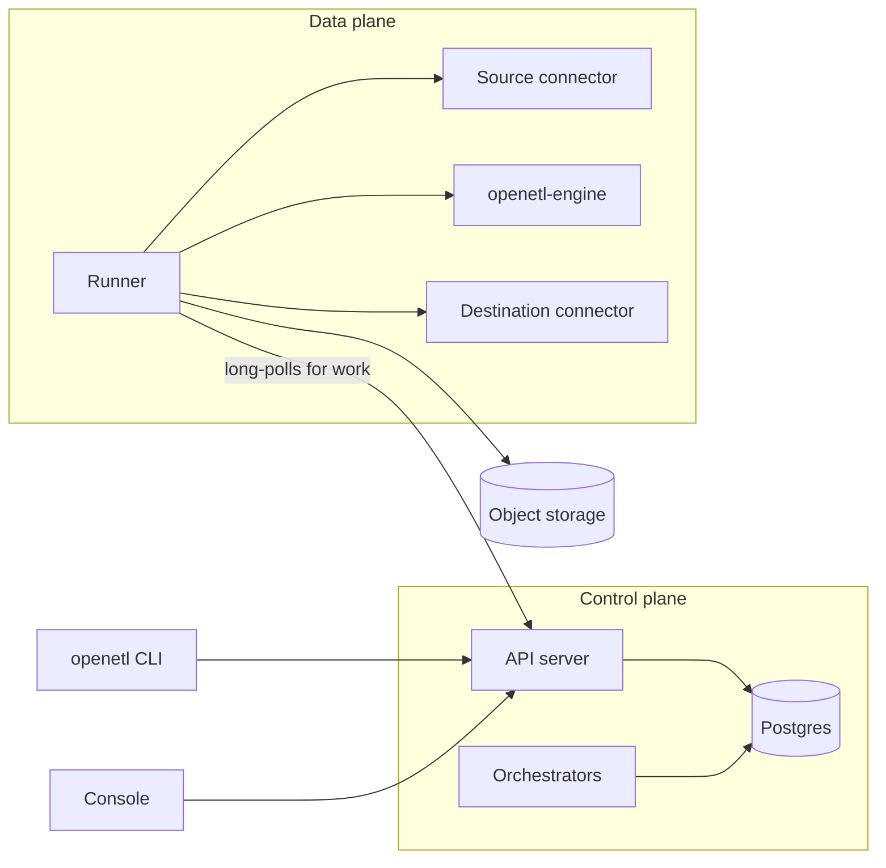

This page is for contributors, and for anyone who wants to know what happens between `openetl apply` and rows landing in a table. It names the packages that do each part. [CONTRIBUTING.md](../../CONTRIBUTING.md) has how to build and test them.

## The parts

`openetld` is one program with roles, which [`internal/daemon`](../../internal/daemon) runs alone or together: `server` serves the API and the console, `orchestrator` runs workflows and places work, and `runner` runs attempts. `dev` runs all three in one process.

## The API

[`internal/api`](../../internal/api) serves the public API, defined in [`proto/openetl/api/v1`](../../proto/openetl/api/v1), over Connect, gRPC, gRPC-Web and REST; the REST routes are the protos' `google.api.http` rules, transcoded by Vanguard, and `internal/api/openapi.yaml` is generated from them. The CLI and the console are clients of this API and nothing else. [`internal/webui`](../../internal/webui) serves the built console next to it, on one origin.

Runners use `DataPlaneService`, in [`proto/openetl/dataplane/v1`](../../proto/openetl/dataplane/v1), with their data plane's runner token, which is served only that data plane's work. [`internal/auth`](../../internal/auth) makes API keys and runner tokens, and defines the roles keys act with.

## The metadata store

[`internal/store`](../../internal/store) is the metadata database, on Postgres: its goose migrations, and the queries from which sqlc generates `internal/store/db`. Every query outside the `orgs` table is scoped by `org_id`, which `TestQueriesAreOrgScoped` checks.

Secrets' values are sealed before they're stored ([`internal/secrets`](../../internal/secrets)): each org has a data key that seals its values with AES-256-GCM, and the installation's key-encryption key, a local key or a KMS key, wraps the data keys. A secret can also be a reference to AWS Secrets Manager, GCP Secret Manager or Azure Key Vault, which runners read with their own cloud identity ([`internal/secretstore`](../../internal/secretstore)).

## Orchestration

Workflows decide what runs when: a schedule for each scheduled pipeline, a supervisor for each continuous one, a workflow for each sync, and the light operations such as discovering a source's catalog. They're written against one interface in [`internal/orchestration`](../../internal/orchestration), and run on either of two backends: DBOS, the default, which keeps workflows in Postgres, or Temporal.

A workflow does no I/O itself; steps do. After a crash a workflow runs again from its start, and every call it made returns what it returned the first time, so a workflow has no clocks, randomness or goroutines of its own. A change that would make a running workflow take another path is guarded by `Context.Version`.

Workflows send work to data planes through the API ([`internal/orchestration/dispatch`](../../internal/orchestration/dispatch)): dispatch rows in Postgres, leases, and long polls that wake the workflows waiting for results. `sizing` works out how large a pipeline's next attempt is, and `scaling` is the job loop that rescales a continuous pipeline's job when its lanes call for more or fewer.

## Runners

A runner ([`internal/runner/worker`](../../internal/runner/worker)) reports itself to the API, long-polls for work, runs it, and reports the result. Each attempt is placed on a runner of the pipeline's data plane and pool with room for its size, or on a pod launcher ([`internal/runner/pods`](../../internal/runner/pods)), which makes a Kubernetes pod for that one attempt; the pod runs `openetld runner` and takes the attempt from the API. [Install on Kubernetes](../self-host/kubernetes.md) explains sizes, pools and placement as an operator sees them.

An attempt ([`internal/runner`](../../internal/runner)) hosts the connectors, drives the dataflow and coordinates checkpoints. Built-in connectors run in the runner; external ones run as processes of their own that it starts, serving the connector protocol on a Unix socket, with host services, such as HTTP with retries and secrets, served back to them ([`internal/connectorhost`](../../internal/connectorhost)).

## The engine

[`openetl-engine`](../../crates/engine) is the Rust data engine. The runner starts one engine process per job and drives it over two kinds of socket: a control channel, `EngineService` in [`proto/openetl/engine/v1`](../../proto/openetl/engine/v1), and data edges that carry frames, each a 12-byte header and an Arrow IPC payload.

The runner sits between the connectors and the engine. Its source pump is the source connector's emitter, and sends what the source reads to the engine's inbound edges. On each lane, the engine:

- turns raw rows into Arrow, inferring each stream's schema from what it sees and only ever widening it, and coerces values to the types a source declares ([`crates/normalize`](../../crates/normalize));
- sets aside the records it can't take, with a reason, as JSON lines under the pipeline's `_quarantine/` in object storage;
- applies the pipeline's schema policy, gives tables and columns their destination names, which never change once given, and adds the metadata columns, `_openetl_id` among them;
- holds back the columns and cells the destination can't take, and keeps their values for a later release;
- routes rows by key group to writer lanes, which write to the runner, with barriers in band, or stage Parquet files, for a destination that loads them and for the built-in `parquet` destination.

The runner's sink pumps hand each writer lane's batches to the destination connector's writer.

## Checkpoints

Each pipeline has a checkpoint log in object storage ([`internal/checkpoint`](../../internal/checkpoint)), under `{org}/{pipeline}/_checkpoints/`: immutable records, one for each checkpoint, and a `HEAD` that points to the latest. `HEAD` is only ever changed by compare-and-swap, with conditional writes on S3, GCS and Azure Blob Storage, so two attempts can't both move it.

An attempt starts by claiming the pipeline: it writes `HEAD` under the next generation. An older attempt that's still running, a zombie, fails its next write to `HEAD` with `ErrFenced`, and stops. A record holds each stream's resume state and schema, the committables the destination's writer lanes staged for the epoch, and the files staged or quarantined in it.

The same storage holds, next to the log, each attempt's log as JSON lines (`_logs/`), staged epochs (`_staging/`), held values (`_held/`) and quarantined records (`_quarantine/`).

## The commit protocol

Data is committed in **epochs**: the records between two checkpoints. For each one:

1. The coordinator asks for barrier N. The source pump places it on each split right after that split's next resume point, so every barrier sits at a place the source can restart from.
2. The barrier travels in band through the engine to every writer lane. Once every stream has crossed it on a lane, the lane's writer runs `PreCommit(N)`: its part of the epoch is durable, but not visible, and it returns a committable.
3. The coordinator writes record N to the checkpoint log and moves `HEAD` to it. This is the commit point.
4. Lane 0's writer runs `Commit(N)`, which makes the epoch visible with a marker per stream, behind the destination's fence. It's idempotent, so it's retried; if it still fails, the attempt fails, and the next attempt's `Recover` applies the epoch from the committables in its record.
5. The source is told, a checkpoint behind, what it may acknowledge upstream, such as Kafka offsets or a replication slot's position.

Commits run one at a time, in epoch order, while barriers for later epochs go on being placed.

When an attempt starts, after claiming the pipeline, its writer runs `Recover`: it raises the destination's fence to the new generation, so a zombie's commits fail there too, and checks the epoch `HEAD` points to. The epoch was applied, or is applied now from its committables, or is lost and the log goes back to the record before it. The attempt then reads from the resume states of the record it settled on.

A split that takes too long to reach a resume point can have its barrier forced, without one, but only where the stream keeps the delivery level the pipeline requires; restoring from such a record reads some rows again. The [`test/sim`](../../test/sim) simulation exercises all of this.

## Delivery levels

[`internal/delivery`](../../internal/delivery) works out each stream's guarantee from the destination's class, the source's replay, the write mode, the primary key and the level the pipeline requires:

- An exact source into a stage-and-apply or transactional destination is **exactly once**: the protocol alone keeps every record to one commit.
- A superset source written with merge into a stage-and-apply destination is **effectively once**: a repeat lands on the same key, guarded by `_openetl_seq`, so the table ends up the same.
- A superset source written with append or overwrite into a destination that can skip rows by `_openetl_id` when it applies is exactly once, when the pipeline requires more than at least once.
- A destination that delivers and acknowledges, and anything else, is **at least once**.

[`internal/plan`](../../internal/plan) uses it to plan a pipeline version from its source's latest catalog, and the runner checks again before each sync, against the catalog it discovers.

## Around the data path

- **Incidents** ([`internal/heal`](../../internal/heal)) are opened and resolved, and their playbooks run, in the same transaction as the report that shows them.
- **Platform events** ([`internal/events`](../../internal/events)) are written to an outbox in the transaction that changes what they report, and delivered to webhooks, signed as the Standard Webhooks spec says ([`internal/webhooks`](../../internal/webhooks)).
- **Outbound connections** go through [`internal/netguard`](../../internal/netguard), which checks every address after DNS resolution, against server-side request forgery.
- **Transforms** run on the user's own clusters: [`internal/spark`](../../internal/spark) runs Spark applications, and [`internal/flink`](../../internal/flink) a continuous pipeline's Flink job, with [`libs/`](../../libs) holding what runs on those clusters.

## How it's tested

- **Unit tests** (`make test`) need no Docker.
- **The simulation**, [`test/sim`](../../test/sim), runs the real runner against fake sources and sinks for each kind of destination, with injected faults, crashes and zombie attempts, choosing every interleaving from a seed. It checks nothing is lost, nothing is duplicated where a stream is exactly once, and the final rows are right where it's effectively once. `make sim SEEDS=10000` runs more seeds, and `go test ./test/sim -run 'TestSimulation/kafka' -seed=42 -v` replays one with its trace.
- **End-to-end tests**, [`test/e2e`](../../test/e2e), run the whole stack against the compose services and the official connectors, one test at a time.
- **The chaos suite**, in `test/e2e`, runs randomized pipelines while runners, engines and connectors die, runners lose the API and the object store fails, and checks every row landed once.
- **Recorded workflow histories**, in `internal/orchestration/workflows/testdata`, replay against the current workflows, so a change that would break a running workflow on Temporal fails a test.
