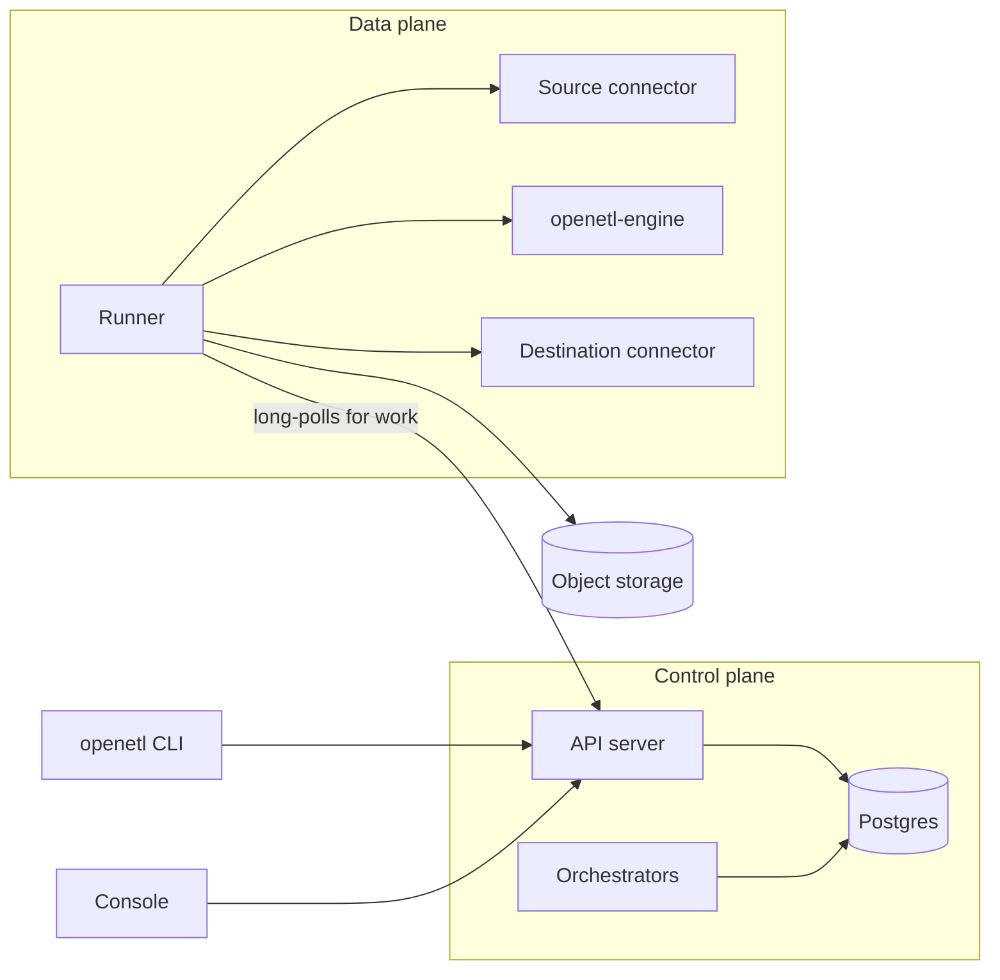

This page explains how OpenETL applies pipeline definitions, executes jobs and commits data. It identifies the packages responsible for each operation. [CONTRIBUTING.md](../../CONTRIBUTING.md) explains how to build and test the code.

## The parts

[`internal/daemon`](../../internal/daemon) runs the roles of the `openetld` program. `server` serves the API and console. `orchestrator` executes workflows and assigns jobs. `runner` executes attempts. `dev` combines all three roles in one process.

## The API

[`internal/api`](../../internal/api) serves the API defined in [`proto/openetl/api/v1`](../../proto/openetl/api/v1) over Connect, gRPC, gRPC-Web and REST. Vanguard transcodes the REST routes from `google.api.http` rules. These rules also generate `internal/api/openapi.yaml`.

The CLI and console use this API. [`internal/webui`](../../internal/webui) serves the built console from the same origin.

Runners call `DataPlaneService`, defined in [`proto/openetl/dataplane/v1`](../../proto/openetl/dataplane/v1). A runner token limits each runner to its data plane's work. [`internal/auth`](../../internal/auth) manages API keys, runner tokens and roles.

## The metadata store

[`internal/store`](../../internal/store) is the metadata database, on Postgres: its goose migrations, and the queries from which sqlc generates `internal/store/db`. Every query outside the `orgs` table is scoped by `org_id`, which `TestQueriesAreOrgScoped` checks.

[`internal/secrets`](../../internal/secrets) encrypts secret values before storage. Each organization has a data key that encrypts values with AES-256-GCM. The installation's local or KMS key wraps those data keys.

Secrets can also reference AWS Secrets Manager, GCP Secret Manager or Azure Key Vault. Runners resolve these references with their cloud identity through [`internal/secretstore`](../../internal/secretstore).

## Orchestration

Workflows manage schedules, continuous-pipeline supervisors, syncs and operations such as source discovery. They use the interface in [`internal/orchestration`](../../internal/orchestration). The default DBOS backend stores workflow state in Postgres. Temporal is the other supported backend.

Steps perform I/O; workflow code does not. After a failure, workflow replay returns the recorded results of previous calls. Workflow code therefore cannot use its own clocks, randomness or goroutines. Changes that alter an existing workflow's execution path require `Context.Version`.

[`internal/orchestration/dispatch`](../../internal/orchestration/dispatch) sends work to data planes through the API. It uses Postgres dispatch records, leases and long polling to deliver results to waiting workflows. `sizing` selects the resources for the next attempt. `scaling` adjusts continuous jobs when their lanes need more or fewer resources.

## Runners

A runner ([`internal/runner/worker`](../../internal/runner/worker)) registers with the API, polls for work, executes it and reports results. Each attempt goes to a runner in the pipeline's data plane and pool with sufficient capacity. A [pod launcher](../../internal/runner/pods) can instead create a Kubernetes pod for one attempt. That pod runs `openetld runner` and obtains the attempt from the API. [Install on Kubernetes](../self-host/kubernetes.md) explains sizes, pools and placement.

An attempt ([`internal/runner`](../../internal/runner)) hosts connectors, drives dataflow and coordinates checkpoints. Built-in connectors run inside the runner. External connectors run as separate processes and serve the connector protocol on Unix sockets. [`internal/connectorhost`](../../internal/connectorhost) supplies host services, including HTTP retries and secrets.

## The engine

[`openetl-engine`](../../crates/engine) is the Rust data engine. The runner starts one engine process per job and communicates through two socket types. The control channel uses `EngineService` from [`proto/openetl/engine/v1`](../../proto/openetl/engine/v1). Data edges carry frames with a 12-byte header and Arrow IPC payload.

The runner sits between the connectors and the engine. Its source pump is the source connector's emitter, and sends what the source reads to the engine's inbound edges. On each lane, the engine:

- turns raw rows into Arrow, inferring each stream's schema from what it sees and only ever widening it, and coerces values to the types a source declares ([`crates/normalize`](../../crates/normalize));
- sets aside the records it can't take, with a reason, as JSON lines under the pipeline's `_quarantine/` in object storage;
- applies the pipeline's schema policy, gives tables and columns their destination names, which never change once given, and adds the metadata columns, `_openetl_id` among them;
- holds back the columns and cells the destination can't take, and keeps their values for a later release;
- routes rows by key group to writer lanes, which write to the runner, with barriers in band, or stage Parquet files, for a destination that loads them and for the built-in `parquet` destination.

The runner's sink pumps hand each writer lane's batches to the destination connector's writer.

## Checkpoints

[`internal/checkpoint`](../../internal/checkpoint) keeps each pipeline's checkpoint log under `{org}/{pipeline}/_checkpoints/` in object storage. Records are immutable, and `HEAD` points to the latest record. Compare-and-swap updates use conditional writes on S3, GCS and Azure Blob Storage. This prevents two attempts from advancing the same `HEAD` concurrently.

An attempt claims the pipeline by writing `HEAD` with the next generation. An older active attempt, called a **zombie**, receives `ErrFenced` on its next `HEAD` write and stops. Each record contains stream resume states and schemas, lane committables, and staged or quarantined file references.

The same storage holds, next to the log, each attempt's log as JSON lines (`_logs/`), staged epochs (`_staging/`), held values (`_held/`) and quarantined records (`_quarantine/`).

## The commit protocol

Data is committed in **epochs**: the records between two checkpoints. For each one:

1. The coordinator requests barrier N. The source pump inserts it after each split's next resume point. This aligns the barrier with a position the source can resume from.
2. The barrier travels through the engine to each writer lane. After all its streams cross the barrier, each lane calls `PreCommit(N)` and returns a committable. The lane's data is durable. Stage-and-apply and transactional destinations keep it invisible until commit; deliver-and-acknowledge destinations have already delivered it.
3. The coordinator writes record N to the checkpoint log and moves `HEAD` to it. This is the commit point.
4. Lane 0's writer calls `Commit(N)`. Stage-and-apply destinations make the epoch visible with stream markers protected by the destination fence. Commit is idempotent and can be retried. If retries fail, the next attempt's `Recover` applies the epoch from its recorded committables.
5. The source receives the positions it can acknowledge upstream, such as event offsets or a replication position. This notification is one checkpoint behind.

Commits run one at a time, in epoch order, while barriers for later epochs go on being placed.

After claiming the pipeline, an attempt calls its writer's `Recover`. This raises the destination fence to the new generation, preventing zombie commits. It then checks the epoch referenced by `HEAD`.

The epoch can be already applied, recoverable from its committables, or lost. If it is lost, the log returns to the preceding record. The attempt reads from the resume states in the selected record.

A delayed split can use a forced barrier without a resume point only when replay preserves the required delivery guarantee. Recovery from that checkpoint reads some records again. The [`test/sim`](../../test/sim) simulation exercises the protocol.

## Attempts on workers

An attempt can run on several runners: one runner coordinates it, and the others, its workers, run its lanes. They use the attempt protocol, `openetl.attempt.v1` ([`internal/runner/attempt`](../../internal/runner/attempt)). Each worker opens one call to the coordinator. The coordinator claims the pipeline, writes the records and decides when each epoch commits. It runs no connector and holds no destination credentials:

- Before the coordinator assigns work, the first worker opens the attempt's first writer lane. It raises the destination fence and settles the epoch that `HEAD` points to, as the recovery of a single runner does. It also gets the splits of the reads that start.
- Each worker reads its splits with its own source connector and runs its own engine. It writes its writer lanes with its own destination writers.
- All the splits of these streams go to one worker:
  - a stream written with overwrite;
  - a stream that the attempt does not read;
  - a keyed stream whose splits do not keep a key's rows together.
- A worker sends its share of each epoch when its part is durable. The share holds its splits' positions, its rows, its committables and what its engine reported. The coordinator merges the shares into one record, which also says what each committable holds.
- After the record, the first worker applies schemas and commits at the coordinator's request. The coordinator then sends the record's positions to the workers. Each worker acknowledges only the positions of its own splits, one checkpoint behind.
- Each stream's schema has one owner, the coordinator. An engine whose lane changes a schema proposes the change from the version that it has. Integers past ±2^53 in a column are such a change too, because a later float then makes the column text. Every engine shapes by the versions that the coordinator accepts.
- A lost worker or a lost coordinator fails the attempt. The next attempt restores every worker from the record, in a new layout.

These jobs run on one runner:

- a job with a transform;
- a job whose streams hold columns;
- a job whose destination loads staged epochs or is written by the engine;
- a job whose destination commits each writer lane's transaction separately;
- a job whose destination takes fewer writer lanes than there are workers.

## Delivery levels

[`internal/delivery`](../../internal/delivery) works out each stream's guarantee from the destination's class, the source's replay, the write mode, the primary key and the level the pipeline requires:

- An exact source into a stage-and-apply or transactional destination is **exactly once**: the protocol alone keeps every record to one commit.
- A superset source written with merge into a stage-and-apply destination is **effectively once**: a repeat lands on the same key, guarded by `_openetl_seq`, so the table ends up the same.
- A superset source written with append or overwrite into a destination that can skip rows by `_openetl_id` when it applies is exactly once, when the pipeline requires more than at least once.
- A destination that delivers and acknowledges, and anything else, is **at least once**.

[`internal/plan`](../../internal/plan) uses it to plan a pipeline version from its source's latest catalog, and the runner checks again before each sync, against the catalog it discovers.

## Around the data path

- **Incidents** ([`internal/heal`](../../internal/heal)) are opened and resolved, and their playbooks run, in the same transaction as the report that shows them.
- **Platform events** ([`internal/events`](../../internal/events)) are written to an outbox in the transaction that changes what they report, and delivered to webhooks, signed as the Standard Webhooks spec says ([`internal/webhooks`](../../internal/webhooks)).
- **Outbound connections** go through [`internal/netguard`](../../internal/netguard), which checks every address after DNS resolution, against server-side request forgery.
- **Transforms** run on the user's own clusters: [`internal/spark`](../../internal/spark) runs Spark applications, and [`internal/flink`](../../internal/flink) a continuous pipeline's Flink job, with [`libs/`](../../libs) holding what runs on those clusters.

## How it's tested

- **Unit tests** (`make test`) need no Docker.
- **The simulation**, [`test/sim`](../../test/sim), runs the real runner with fake sources and destinations. A seed selects fault timing, failures and zombie attempts. Checks cover data loss, exactly-once duplicates and final rows under effectively-once delivery. `make sim SEEDS=10000` runs more seeds. `go test ./test/sim -run 'TestSimulation/kafka' -seed=42 -v` replays one seed with its trace.
- **End-to-end tests**, [`test/e2e`](../../test/e2e), run the whole stack against the compose services and the official connectors, one test at a time.
- **The chaos suite**, in `test/e2e`, runs randomized pipelines while runners, engines and connectors die, runners lose the API and the object store fails, and checks every row landed once.
- **Recorded workflow histories**, in `internal/orchestration/workflows/testdata`, replay against the current workflows, so a change that would break a running workflow on Temporal fails a test.
