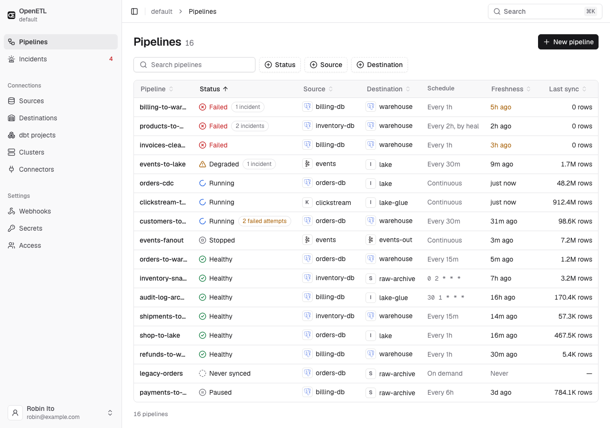

Open **Pipelines** to check whether your data is current. Select a pipeline to see its streams and latest results.

## Check the latest delivery

1. Find the pipeline that supplies your data.
2. Check **Freshness** for its latest successful delivery time.
3. Select the pipeline.
4. Check **Overview** for incidents and affected streams.

For a continuous pipeline, check **Last commit** and **Behind source**. **Behind source** shows the reported lag at the latest commit.

In this example, the first pipeline failed and last delivered data 5 hours ago. The list places pipelines that need attention first.

If the result needs attention, [review incidents](./incidents.md). Give the pipeline name and incident details to the person responsible for the connection.

## Pipelines

**Pipelines** lists every pipeline, the most urgent first. Search by name, or filter by **Status**, **Source** or **Destination**.

| Column | What it shows |
|---|---|
| **Pipeline** | Its name. Open it for its page. |
| **Status** | The latest sync result, as defined below. During retries, it includes the failed-attempt count. Open incidents also have a count. |
| **Source**, **Destination** | Where it reads from and writes to. |
| **Schedule** | The run frequency: **Every 1h**, a cron expression, **Continuous**, or **On demand**. An on-demand pipeline runs when someone starts it. |
| **Freshness** | The latest successful sync's end time. For a continuous pipeline, this is the latest commit time. OpenETL highlights an interval-based pipeline after two intervals without success. |
| **Last sync** | How many rows its latest sync copied. |

If a pipeline is paused, its status is **Paused**. Otherwise, its status comes from the latest sync:

| Status | Meaning |
|---|---|
| **Healthy** | The latest sync succeeded. |
| **Running** | A sync is running now. |
| **Degraded** | The latest sync succeeded with quarantined rows or held columns. Open the pipeline to inspect the affected data. |
| **Failed** | The latest sync failed. |
| **Paused** | The pipeline does not start scheduled syncs. An active scheduled sync can continue. |
| **Stopped** | A continuous pipeline's run stopped after a stop request, such as a pause or a new version. |
| **Never synced** | The pipeline has not synced. |

## A pipeline's page

The top of a pipeline's page has its status, and:

- **Source** and **Destination**, with the schema it writes into.
- **Transform** identifies Spark or Flink and its cluster. A pipeline with SQL statements shows **SQL**.
- **Schedule**, or **Paused**.
- **Last success**, or **Last commit** for a continuous pipeline, which is its freshness.
- **Behind source**, for a continuous pipeline: how far its reading was behind the source at its latest commit.
- **Size**: how much CPU and memory its syncs get, and why.
- **Version**: the current pipeline version. Select it to inspect the definition.

The strip below the header shows recent syncs, oldest on the left. Color indicates status. Length indicates duration. Point to a sync to see its row count. Select a sync to open it.

### Overview

**Overview** first shows open incidents, retries after failed attempts and the latest failed sync. It links to the failed sync's log.

**Not as the spec says** identifies active differences from the pipeline definition:

- A **Paused** stream is skipped while its saved position is retained. The entry explains why and links to the incident if heal paused it. **Resume stream** enables reads again.
- **Changed by heal** identifies a setting changed by automatic recovery. It shows the active value beside the pipeline definition's value. **Use the spec's** restores the definition's value. While a schedule override applies, the header's **Schedule** shows that interval.

A diagram shows the source, streams, destination and steps that run after a sync. The **Streams** table has a row for each stream:

| Column | What it shows |
|---|---|
| **Stream** | The table, topic or stream it reads, marked **Paused** if syncs skip it. |
| **Read** | How it is read: full refresh, incremental (and on which column), CDC or stream. **Source default** when the pipeline leaves it to the source. |
| **Write** | How it is written: append, overwrite or merge. |
| **Delivery** | Its [delivery guarantee](../get-started/concepts.md#delivery-guarantees): **Exactly once**, **Effectively once** or **At least once**. Point to it for the reason. **Checked when it syncs** means OpenETL checks the guarantee before each sync. |
| **Schema** | Its schema's version. Click it to see the columns. |
| **Rows** | Rows the latest sync copied. |
| **Quarantined** | Rows that the latest sync did not write. OpenETL saves each row with its reason. See [quarantine](../get-started/concepts.md#holds-and-quarantine). |
| **Held** | Columns with values [held back](../get-started/concepts.md#holds-and-quarantine) from rows that OpenETL wrote. A release of the hold writes the values into the same rows. |
| **Collapsed** | Repeated rows that were not written again, because a row with the same ID was already there. |

Messages above the table identify plan errors, warnings and checks that could not run.

If data needs attention, [review incidents](./incidents.md) or [inspect held and quarantined data](./held-data.md).
