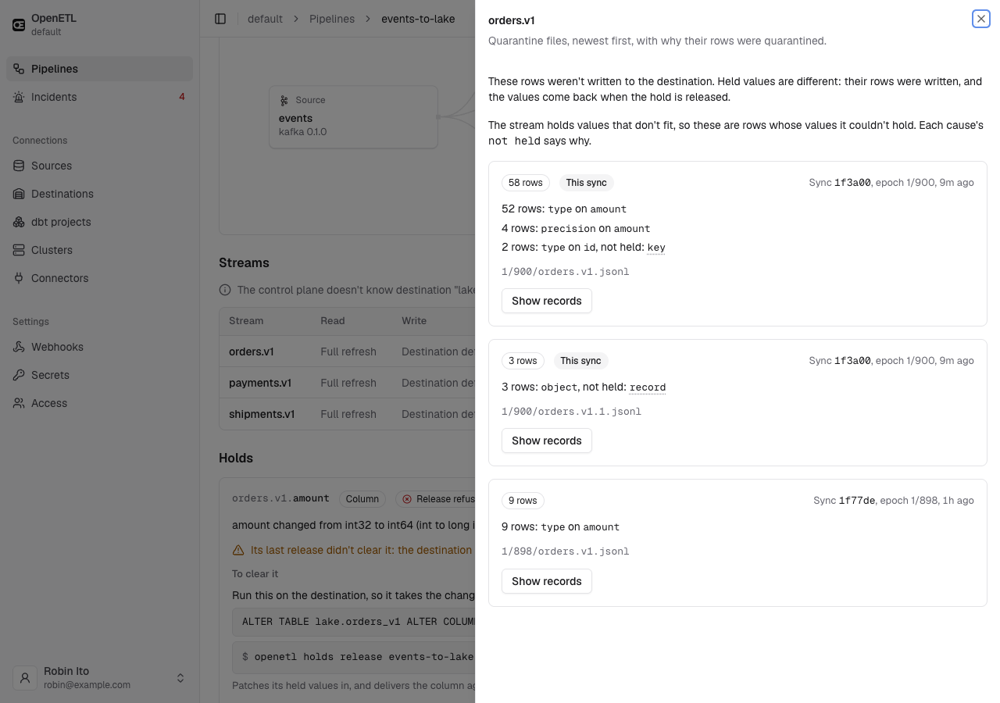

Open the pipeline’s **Overview** tab. Check **Held** and **Quarantined** in the **Streams** table.

A hold keeps values from a row that OpenETL writes. Quarantine keeps a whole row out of the destination.

## Held values

If the pipeline holds values, **Holds** lists each affected column. Entries identify whole-column or individual-cell holds, their start time, reason and current state:

| State | Meaning |
|---|---|
| **Held** | Its values are kept until someone releases or discards them. |
| **Pending** | It was released or discarded, and waits for the pipeline's next run. |
| **Releasing** | Its held values are being written in. |
| **Release refused** | The last release did not clear the hold. Another release request is required before OpenETL tries again. |
| **Discarded** | Its values were dropped. The column stays as the destination has it. |

**To clear it** lists recovery choices in recommended order. These can include destination repairs and commands to release or discard the hold.

If you cannot make the repair, give these details to your pipeline administrator. [Handle schema changes and holds](../pipelines/schema-changes.md) gives the repair and release procedure.

## Quarantined rows

A number in **Quarantined** links to the stream's quarantine files. Select it to inspect the files.

You can open this link from the **Streams** table, **Syncs**, **Checkpoints**, or a sync's page. Quarantined rows are not in the destination. A hold affects values in rows that OpenETL has written.

The panel lists the stream's files, newest first. Each file shows:

- its rows, and **Output** if the stream is an output of a SQL transform;
- the sync that committed it, its epoch, and when it committed;
- its rows by cause, such as 312 rows: `type` on `amount`;
- its path below the pipeline's `_quarantine/` folder in the data plane's storage.

In this example, the first two files belong to the selected sync. **This sync** identifies them.

A file of the sync or checkpoint that you selected is marked **This sync** or **This checkpoint**. Select **Load older files** to see more. A cause names a code, and the column if one column caused it. [Quarantine files](../reference/quarantine-files.md#codes) explains each code.

If the stream holds values that do not fit (`unfitValues: hold`), a cause can also show **not held**. These rows had values that OpenETL could not hold, so it quarantined the rows. Point to the word after **not held** to see why.

If you have the editor role or higher, each file has **Show records**. Select it to inspect the first 20 records and their reasons. The panel shows at most 256 KiB of records.

A runner reads the records from the data plane's storage. The audit log records each read. OpenETL does not keep a separate copy of the preview. The file stays in storage until the pipeline's retention policy or a storage rule deletes it.

If the file has more records, the panel shows the command that reads up to 100. If the first record is larger than 256 KiB, the panel and the command cannot show it. Read it from the file in the data plane's storage.
