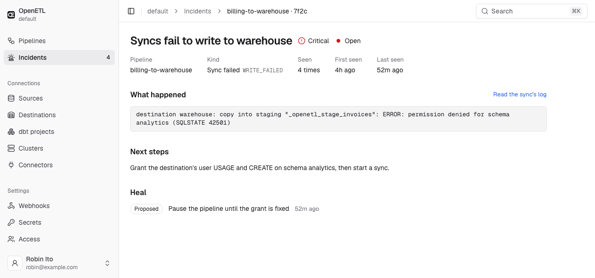

Open **Incidents** to find conditions that need attention. Start with the incident’s **What happened** and **Next steps** sections.

## Incidents

An incident records a condition that needs attention. **Incidents** lists incidents across pipelines, with open incidents first. Each entry shows a summary, **Severity**, **State**, **Kind**, **Seen** count and **Last seen** time. Filter by **State**, **Severity**, **Pipeline** or **Kind**.

There are two severities:

- **Critical**: data has stopped flowing, or will be lost.
- **Warning**: data still flows, or will soon stop if nothing changes.

And these kinds:

| Kind | What happened |
|---|---|
| **Sync failed** | A sync failed with an error no other kind covers. |
| **Auth** | A source or destination refused its credentials, or they expired. |
| **Schema blocked** | A stream's schema changed in a way the pipeline does not take. |
| **Rate limited** | The source kept limiting requests until the sync ran out of retries. |
| **Position lost** | The source no longer retains the saved read position. The pipeline cannot resume from that position. |
| **Crash loop** | A continuous pipeline's attempts fail or lose their runner, three in a row within a day, without committing anything. |
| **Lagging** | A continuous pipeline has fallen too far behind its source. |
| **Retention at risk** | The pipeline's backlog uses at least half the source's retention capacity, such as its retained change log. |
| **Quarantine** | A stream quarantines a large share of its rows, so OpenETL does not write them. |
| **Held** | A stream is holding a column, or some of its cells, back. |
| **Checkpoint corrupt** | The checkpoint the pipeline would carry on from cannot be read, or the pipeline restarted from the one before it. |

An incident page has four sections:

- **What happened** describes the condition and links to the sync log.
- **Next steps** gives recovery instructions.
- **Heal** records automatic actions or proposed actions.
- **Details** provides additional diagnostic information.

This example requires a database permission change. If you cannot make the change, contact the person responsible for that database. Give them the pipeline name and **What happened** details.

Some incidents pause the pipeline because another sync would repeat the failure. Others change how it runs:

For **Quarantine**, automatic recovery can pause the affected stream while other streams continue. If it is the only stream, automatic recovery pauses the pipeline. Some streams, such as CDC streams, cannot pause independently. **Next steps** explains this limit.

**Next steps** identifies the newest quarantine file and gives the command to list files. **Details** shows the file count from the preceding hour under `quarantine_files`. It identifies the newest files under `quarantine_paths`. Each quarantined row includes its reason.

For **Rate limited**, automatic recovery reduces the request rate where supported or increases the sync interval. It acts after 3 consecutive rate-limit failures. It repeats the adjustment after every 3 further failures.

The pipeline's **Overview** shows these changes under **Not as the spec says**. The available actions let an operator undo them.

The pipeline definition controls automatic recovery. It can permit actions, request proposals, or disable recovery actions.

Most incidents resolve automatically when the pipeline makes progress. If you repaired a condition that OpenETL cannot detect, an operator can select **Resolve**. An optional **Comment** records the repair.

If the condition recurs, a new incident opens. A **Lagging** incident reopens at the next checkpoint if the pipeline is still behind.

For a pipeline that waits, fails repeatedly or stops delivering fresh data, follow [Troubleshoot a pipeline](../pipelines/troubleshooting.md). [Handle schema changes and holds](../pipelines/schema-changes.md) shows a complete hold and release.
